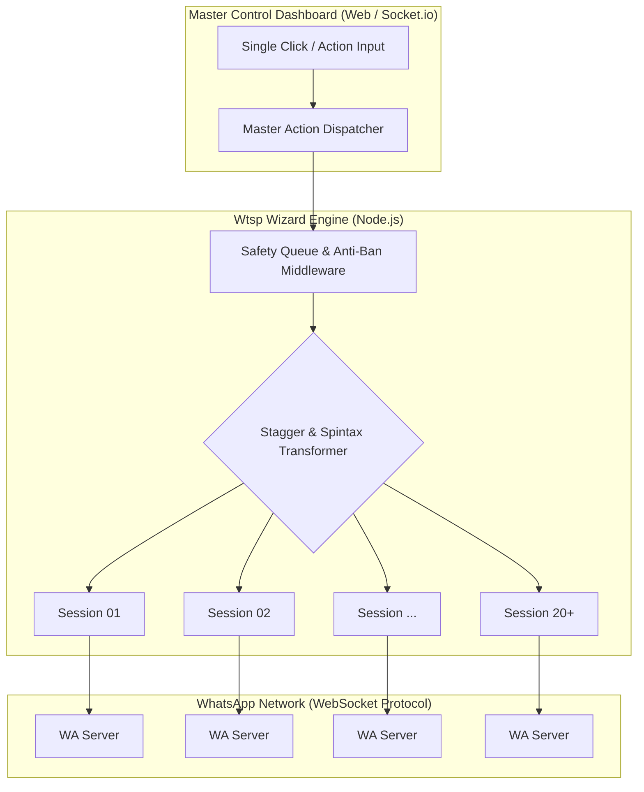

# 🧙‍♂️ Wtsp Wizard — Multi-Session WhatsApp Orchestrator & Action Mirror

[](https://nodejs.org/)
[](https://github.com/WhiskeySockets/Baileys)
[](#architecture)
[](LICENSE)

**Wtsp Wizard** is a high-concurrency, lightweight WhatsApp multi-account orchestrator designed to mirror actions and control **20+ WhatsApp sessions simultaneously** from a single unified master dashboard.

Built for community managers, marketing operations, and synchronized team automations, it leverages raw WebSocket connections (`@whiskeysockets/baileys`) rather than heavy headless browsers, keeping total system memory usage under **1 GB RAM for 20+ accounts**.

---

## ⚡ Core Highlights

- **Master Puppet / Action Mirroring**: Trigger an action (message, reaction, group join) once from the master interface and replicate it across all 20+ linked accounts automatically.
- **Ultra-Lightweight Concurrency**: Built with Baileys WebSocket protocol (~25–40MB RAM per account vs ~800MB per headless browser instance).
- **Anti-Ban Human Emulation Safeguards**:
  - **Dynamic Jitter & Staggered Queue**: Random delays (1–3s configurable) between accounts to prevent simultaneous burst detection.
  - **Spintax Engine**: Automatic message variations (`{Hello|Hi|Hey}`) so outgoing payloads are not byte-identical.
  - **Proxy Routing (Optional)**: Support for per-session HTTP/SOCKS5 proxies to distribute IP origin.
- **Session Lifecycle Management**: Multi-QR scan manager with persistent authentication storage (`useMultiFileAuthState`) so sessions survive restarts without re-scanning.
- **Real-Time Control Room**: Web dashboard with live session status indicators (Online, Offline, QR Pending, Disconnected) and action execution telemetry.

---

## 🏗️ Architecture Overview



---

## 🚀 Key Feature Matrix

| Feature | Description | Status |
| :--- | :--- | :--- |
| **Multi-QR Session Hub** | Generate independent pairing QRs and manage 20+ authenticated sessions | 🟡 In Progress |
| **Broadcast Mirror** | Send targeted or bulk messages mirrored from all active accounts | 🟡 In Progress |
| **Reaction Sync** | Mass-react with emojis to specific messages across all sessions | 📋 Planned |
| **Group Join Replicator** | Feed a WhatsApp invite link and have all accounts join automatically | 📋 Planned |
| **Presence & Typing Emulator** | Simulate synchronized human typing or online status before dispatches | 📋 Planned |
| **Per-Account Proxy Routing** | Route individual account WebSocket traffic via dedicated proxies | 📋 Planned |

---

## 🛠️ Tech Stack

- **Backend**: Node.js (v18+), Express.js, Socket.io
- **WhatsApp Engine**: `@whiskeysockets/baileys` (Multi-device WebSocket)
- **Session Storage**: Multi-file distributed auth state store (`auth_info_multi/`)
- **Frontend Dashboard**: Tailwind CSS, Real-time WebSockets
- **Queue & Jitter**: In-memory priority queue with jitter & rate-limiting

---

## 📦 Getting Started

### Prerequisites
- [Node.js](https://nodejs.org/) v18.0.0 or higher
- Git installed on host machine

### Installation

```bash
# Clone the repository
git clone https://github.com/slurrxglobal-web/wtsp-wizard.git

# Enter project directory
cd wtsp-wizard

# Install dependencies
npm install

# Start development server
npm run dev
```

---

## 🛡️ Responsible Usage & Disclaimer

This project is intended strictly for authorized community management, educational research, and internal team automation. Sending unsolicited commercial messages or violating WhatsApp's Terms of Service is strongly discouraged. Use responsibly with appropriate delays and safety settings.
